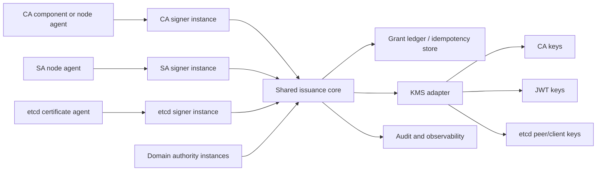

# Kubernetes Credential Issuance Platform: External Components Implementation Plan

**Status:** Phases 0-3 reference implementations are present; production
hardening and Phase 4 remain open
**Date:** 2026-10-28
**Proposed repository:** `k8s-credential-issuance`

This document archives the implementation plan for the external components shared by Kubernetes CA Issuance V2, ServiceAccount JWT Issuance V2, and etcd CA Issuance V2.

The target architecture is one repository with one shared issuance core, three domain plugins, and multiple isolated runtime instances. Shared code reduces maintenance cost; it does not create a shared trust boundary. Domain-specific keys, identities, policies, ledgers, and runtime credentials remain isolated.

## 1. Architecture decision

The platform has four layers:

1. **Issuance core:** Grant verification, canonical request binding, replay and idempotency, the fail-closed issuance pipeline, KMS brokering, audit, generation state, and common transport.
2. **Domain plugins:** CA/X.509, ServiceAccount/JWT, and etcd peer/client certificate policy and result handling.
3. **External services and agents:** Authority, signer, ledger, KMS adapter, audit sink, rotation controller, and node/worker agents.
4. **Isolated runtime instances:** Separate CA, ServiceAccount, and etcd deployments built from the same repository.



The request domain is not trusted merely because it appears in a request. A signer instance is configured for one domain and rejects requests, Grants, key references, or ledger records from every other domain.

## 2. Repository layout

```text
k8s-credential-issuance/
  api/
    grant/v1/
    signrequest/v1/

  internal/issuance/
    core/
      pipeline/
      grant/
      ledger/
      kms/
      audit/
      generation/
      transport/
    domains/
      ca/
        csr/
        profiles/
        x509issuer/
        status/
      sa/
        claims/
        jwtissuer/
        jwks/
      etcd/
        membership/
        peer/
        client/
        quorum/

  internal/authority/
    core/
    domains/ca/
    domains/sa/
    domains/etcd/

  internal/agent/
    client/
    identity/
    transport/
    retry/

  cmd/
    ca-authority/
    ca-signer/
    ca-cert-agent/
    ca-rotation/
    sa-authority/
    sa-signer/
    sa-node-agent/
    etcd-authority/
    etcd-signer/
    etcd-cert-agent/
    etcd-rotation/
```

The commands may use the same implementation and build system, but each production process receives a fixed domain configuration and an independent identity.

## 3. Shared issuance core

### 3.1 Grant envelope

The core owns the signed outer envelope. Its fields include:

```text
version
domain
grant_id
request_id
identity_ref
binding_digest
generation
key_id
policy_version
not_before / expires_at
nonce
typed domain payload
signature
```

The payload is domain-typed and canonically encoded. A CA Grant binds a CSR digest, public-key digest, signer profile, SANs, usages, and TTL. An SA Grant binds claims, ServiceAccount UID, optional Pod UID, audience, issuer, cluster ID, and TTL. An etcd Grant binds cluster instance, member or client identity, endpoint SAN, peer/client profile, etcd roles, public key, generation, and TTL.

The core must reject an unknown domain, version, algorithm, key ID, or payload type. It must never treat a generic map of caller-controlled fields as an authorization policy.

### 3.2 Issuance pipeline

The core owns the order of security-sensitive operations:

```text
authenticate request
  -> load the latest request
  -> domain canonicalization and digest
  -> verify Grant signature and time bounds
  -> validate exact domain binding and policy
  -> atomically reserve the Grant
  -> create a constrained SigningIntent
  -> call the permitted KMS key
  -> persist the exact result
  -> deliver the result through the domain adapter
  -> write the audit event
```

The domain plugin supplies parsing, binding, policy, signing-template, and result-delivery hooks. It cannot bypass Grant reservation, KMS allowlists, idempotency, or audit handling.

### 3.3 Shared interfaces

The interfaces should be typed and narrow. The following design shape freezes the
contract boundary; implementation may choose equivalent types without changing
the documented semantics:

```go
type IssuancePlugin interface {
    Domain() Domain
    Canonicalize(ctx context.Context, request Request) (Binding, error)
    ValidateBinding(ctx context.Context, grant Grant, binding Binding) error
    Prepare(ctx context.Context, grant Grant, binding Binding) (SigningIntent, error)
    Finalize(ctx context.Context, result SignedResult) (Delivery, error)
}

type Ledger interface {
    Reserve(ctx context.Context, key ReservationKey) (Reservation, error)
    Complete(ctx context.Context, operationID string, result SignedResult) error
    Lookup(ctx context.Context, operationID string) (SignedResult, error)
}

type KeyProvider interface {
    Sign(ctx context.Context, intent SigningIntent) (Signature, error)
}

type Agent interface {
    Domain() Domain
    Request(ctx context.Context, request AgentRequest) (AgentResult, error)
    Verify(ctx context.Context, result AgentResult) error
    Deliver(ctx context.Context, result AgentResult) error
}
```

`KeyProvider` is an internal broker, not a public arbitrary-byte signing API. It enforces domain, purpose, algorithm, key reference, and operation ID allowlists before calling Infisical KMS or another approved HSM/KMS.

### 3.4 Ledger and result recovery

The ledger is outside the control-plane trust boundary and must support atomic reservation across signer instances. A reservation records the Grant ID, domain, request digest, target identity, CSR or claims UID where applicable, operation ID, and key generation.

After a KMS success, the exact certificate or token result is persisted before delivery. If the signer crashes after KMS signing, a retry returns the recorded result and does not issue a second artifact. The ledger needs durable retryable, completed, revoked, and permanent-failure states, plus audit evidence for every transition.

The backend may be shared by domains, but it must enforce domain namespaces, per-service authorization, and domain-aware uniqueness. High-assurance deployments may use separate physical stores.

## 4. External authority implementation

The authority is a shared service framework with domain-specific registration and policy modules:

```text
authority core
  registration store
  identity verifier / attestation verifier
  policy engine
  Grant issuer
  revocation and generation blocking
  authority audit
```

Recommended runtime instances are `ca-authority`, `sa-authority`, and `etcd-authority`. They may share source code, but must use separate Grant signing keys, registration namespaces, policy namespaces, mTLS identities, and audit streams.

The authority must never infer authorization only from Kubernetes Nodes, CSR approval, a master-held kubeconfig, or a ServiceAccount token relayed by the untrusted control plane.

## 5. Signer implementation

The signer is a common service shell around one domain plugin:

```text
protocol adapter
  -> issuance core
  -> exactly one domain plugin
  -> KMS broker
  -> domain result writer
```

Signer instances are deployed independently:

| Instance | Request path | Result | Required isolation |
|---|---|---|---|
| `ca-signer` | CSR watch/status or constrained direct request | Leaf plus intermediate chain | CA profiles and CA intermediate keys only |
| `sa-signer` | Direct worker/provider request | Bound JWT | JWT keys and JWKS only |
| `etcd-signer` | Direct request or constrained CSR relay | Peer or client certificate chain | Peer/client profiles and keys only |

Each signer has a fixed allowed domain, Grant issuer key set, KMS key set, ledger namespace, and egress policy. The signer cannot approve CSRs, read Secrets, modify RBAC, or use `admin.conf`.

## 6. Domain plugin responsibilities

### 6.1 Kubernetes CA plugin

The CA plugin implements:

- PKCS#10 parsing and exact CSR digest calculation;
- `signerName`, profile, public key, Subject, SAN, EKU, key usage, TTL, and generation binding;
- allowlisted profiles such as `kubelet-client`, `kubelet-serving`, `control-plane-client`, `api-server-serving`, and administrator;
- constrained X.509 templates and leaf-first certificate-chain output;
- CSR status delivery when the compatibility CSR carrier is used;
- trust-bundle publication and profile/generation rotation.

The CA plugin must not accept arbitrary certificate templates or use one online intermediate for unrelated trust domains.

### 6.2 ServiceAccount JWT plugin

The SA plugin implements:

- canonical claims serialization and claims digest;
- exact ServiceAccount, Pod, audience, issuer, cluster, expiration, and generation binding;
- constrained JWT creation through a non-exportable signing key;
- JWKS and key metadata publication;
- active/previous generation overlap and emergency key removal;
- node-agent/provider delivery and projected-token refresh semantics.

The JWT plugin must not expose arbitrary JWT claims or generic byte signing. Production worker identity and attestation are separate deployment responsibilities.

### 6.3 etcd CA plugin

The etcd plugin implements:

- separate `etcd-peer` and client profiles;
- cluster-instance, member/client identity, endpoint SAN, public key, generation, TTL, and role binding;
- peer and client CA key separation;
- certificate installation and reload/restart result handling;
- quorum-aware peer rotation and client rotation;
- membership, snapshot restore, and member replacement lifecycle hooks;
- client identity to etcd user/role mapping.

The plugin cannot perform membership mutation merely because it issued a certificate. Membership operations require a separate authorized workflow.

## 7. Agent implementation

The common agent library provides mTLS, identity exchange, request correlation, bounded retries, local state, and result verification. Domain agents provide the artifact-specific behavior:

- `ca-cert-agent`: local key/CSR generation, Grant acquisition, certificate installation, renewal, and component reload;
- `sa-node-agent`: worker attestation, direct Grant/token requests, kubelet `TokenProvider` or `RemoteProvider`, and Unix-socket delivery;
- `etcd-cert-agent`: peer/client key and CSR generation, separate file permissions, reload/restart, renewal, and quorum-aware scheduling.

Agents must not fall back to local CA signing, auto-TLS, plaintext, or control-plane credentials when the authority or signer is unavailable.

## 8. KMS, trust, and rotation

The repository contains one KMS provider interface and provider adapters, but the production key policies are domain-specific:

```text
CA:   profile/generation-specific X.509 intermediate keys
SA:   active/standby JWT signing keys
etcd: independent peer/client intermediate keys
```

Every adapter must enforce non-exportability, compatible algorithms, key versioning, disable/retirement, short-lived machine identity or mTLS, audit evidence, and operation-ID idempotency or result recovery.

The shared generation state machine handles state transitions and safety checks. Domain controllers implement the effects:

- CA: certificate-chain trust bundles and leaf drain;
- SA: JWKS publication, verifier cache bounds, and token drain;
- etcd: peer/client overlap bundles, member reload/restart, quorum checks, and old-connection drain.

## 9. Runtime isolation contract

Every production instance must have:

- a fixed domain configuration that cannot be changed by a request;
- an independent service identity and mTLS certificate;
- a domain-specific EAA signing-key trust set;
- an allowlist of KMS key references and purposes;
- an isolated ledger namespace and audit stream;
- network policy limiting egress to its authority, ledger, audit sink, and permitted KMS keys;
- independent readiness, metrics, alerts, backup, and recovery procedures.

Sharing a database cluster, KMS endpoint, or binary is acceptable only when these controls remain enforceable. Sharing private keys, signer credentials, or unrestricted policy administration is not acceptable.

### 9.1 Current repository status

The repository now contains runnable reference paths for the frozen CA, SA,
and etcd contracts:

- `api/grant/v1` and `api/signrequest/v1` define the common Grant and direct SA
  request/response types;
- `internal/issuance/core` implements canonical JSON, Compact JWS Grants,
  replay state, ledger reservation/result recovery, constrained KMS intents,
  audit, generation state, transport helpers, and the ordered issuance
  pipeline;
- `internal/issuance/domains/sa` implements the SA plugin, signer, and
  node-agent/provider path;
- `internal/issuance/domains/sa/attestation.go` implements the signed remote
  attestation resolver, request digest binding, replay protection, and
  fail-closed endpoint handling;
- `internal/authority/domains/sa` implements registration, worker proof
  verification, Grant issuance, revocation, and authority endpoints;
- `internal/issuance/domains/ca` implements bounded CSR parsing, profile
  policy, the CA plugin/signer, certificate agent, CSR-status controller, and
  certificate rotation path;
- `internal/authority/domains/ca` implements registration, worker proof
  verification, Grant issuance, revocation, and CA policy endpoints;
- `internal/issuance/domains/etcd` implements peer/client profiles, the etcd
  plugin/signer, direct certificate agent, file installation, and quorum-aware
  rotation;
- `internal/authority/domains/etcd` implements the member/client registry,
  replacement, snapshot restore, role-bound Grant issuance, and revocation;
- `internal/issuance/core/kms/x509.go` implements the constrained development
  X.509 backend and leaf-first chain validation; production still requires an
  external non-exportable KMS/HSM adapter;
- `cmd/sa-authority`, `cmd/sa-signer`, and `cmd/sa-node-agent` provide
  independently deployable process entry points.

The SA plugin also allowlists the supported JWT claim shape and compares its
security-relevant values with the verified binding. A valid claims digest alone
cannot authorize a different audience, issuer, subject, validity window, or
Kubernetes workload UID.

This is a reference implementation, not a production exit. The in-tree file
stores are single-process stores rather than HA transactional backends, the
node-agent now uses a signed remote-attestation resolver when configured (with
the static resolver retained only behind an explicit development flag), and the
commands enforce server-side TLS for non-loopback listeners but do not yet
provision a complete mutual-TLS identity system. The signer accepts the frozen
`issuance/v1` Compact JWS by default; the SA domain also contains an explicit,
opt-in adapter for the legacy Kubernetes staging `TokenGrant` JSON envelope.
The adapter converts the legacy envelope into the typed Grant consumed by the
common core and is covered by wire-shape and end-to-end tests. See the [SA
deployment note](../deployment/sa-issuance.md) for configuration and the
remaining production boundary.

## 10. Implementation TODOs

### Phase 0: Freeze contracts

- [x] **DONE — define the common Grant envelope and domain-tagged payloads.**
- [x] **DONE — define ledger reservation, result recovery, revocation, and audit contracts.**
- [x] **DONE — define KMS `SigningIntent` and per-domain key allowlists.**
- [x] **DONE — define domain plugin and agent interfaces.**

### Phase 0 exit record

**Status:** Complete — documentation and contract freeze, 2026-10-28.

| Checklist item | Evidence | Result |
|---|---|---|
| Grant envelope and typed payloads | [Grant contract](../contracts/issuance-v1.md#3-grant-contract), [domain bindings](../contracts/issuance-v1.md#4-domain-bindings), and §3.1 above | PASS |
| Ledger reservation, recovery, revocation, and audit | [Authority contract](../contracts/issuance-v1.md#6-authority-contract), [ledger contract](../contracts/issuance-v1.md#8-ledger-and-idempotency-contract), and [failure semantics](../contracts/issuance-v1.md#10-errors-retries-and-fail-closed-behavior) | PASS |
| Constrained KMS `SigningIntent` and key allowlists | [KMS contract](../contracts/issuance-v1.md#9-kms-contract) and §§3.3/8 above | PASS |
| Domain plugin and agent interfaces | §3.3 and §7 above, plus [request/signer contracts](../contracts/issuance-v1.md#5-request-and-response-carriers) | PASS |

Phase 0 is closed at the contract/documentation level. The Phase 1 reference
implementation and executable tests are recorded below; deployment and
production acceptance remain separate gates.

### Phase 1: Extract the common platform

- [x] **DONE — implement Grant, replay, ledger, KMS, audit, generation, and transport in `internal/issuance/core`.** Evidence: the package tree under `internal/issuance/core`, package tests, and the ordered pipeline in `internal/issuance/core/pipeline`.
- [x] **DONE — place SA domain behavior behind the SA plugin and keep the direct endpoint JSON shapes.** `issuance/v1` Compact JWS is the default wire format. The SA domain additionally provides an explicit `grant_format=legacy-token-grant` authority mode and `allow_legacy_token_grant=true` signer mode for the old Kubernetes staging `TokenGrant` envelope; the adapter converts it before the common core pipeline. Evidence: `internal/issuance/domains/sa`, `internal/authority/domains/sa`, compatibility tests, and [SA deployment documentation](../deployment/sa-issuance.md).
- [x] **DONE — add cross-domain contract tests and fail-closed tests.** Evidence: pipeline cross-domain, audit-unavailable, KMS-failure, exact-retry, ledger-concurrency/restart, generation, Grant, canonicalization, KMS operation-ID, strict SA claims-binding, transport, and SA end-to-end tests.

### Phase 1 exit record

**Status:** Reference implementation complete — 2026-10-28. Production rollout
is not approved by this record.

| Checklist item | Evidence | Result |
|---|---|---|
| Common core modules and ordered pipeline | `internal/issuance/core/**` and `go test ./...` | PASS |
| SA authority, signer, node-agent, strict claims binding, and direct flow | `internal/authority/domains/sa/**`, `internal/issuance/domains/sa/**`, `TestSignerRejectsClaimsThatDoNotMatchTheBinding`, and `internal/issuance/domains/sa/e2e_test.go` | PASS |
| Cross-domain, fail-closed, concurrency, restart, and exact-retry behavior | `internal/issuance/core/*/*_test.go` and SA E2E test | PASS |
| HA stores, production attestor deployment, complete mTLS identity provisioning, and production KMS/audit deployment | Phase 4 deployment controls | OPEN |
| Legacy staging `TokenGrant` wire compatibility | `internal/issuance/domains/sa/legacy.go`, legacy authority/signer/node-agent E2E and protocol tests | PASS |

### Phase 2: Add CA

- [x] **DONE — implement the CA plugin, CA authority policy, CA signer, certificate agent, and CA rotation/status controllers.** Evidence: `internal/issuance/domains/ca/**`, `internal/authority/domains/ca/**`, generic binding proofs, and the CA end-to-end test.
- [x] **DONE — validate CSR status delivery, profile isolation, certificate-chain output, and CA key restrictions.** Evidence: bounded PKCS#10 parsing, exact Grant/profile binding, `TestCertificateAgentIssuesLeafAndIntermediateWithoutRoot`, `kms.ValidateCertificateChain`, and purpose/profile KMS policies.

### Phase 2 exit record

**Status:** Reference implementation complete — 2026-10-28. Production rollout
is not approved by this record.

| Checklist item | Evidence | Result |
|---|---|---|
| CSR/public-key/signer/profile/SAN/usage/TTL binding | `internal/issuance/domains/ca/csr`, `internal/issuance/domains/ca/plugin.go`, and `internal/authority/domains/ca/authority.go` | PASS |
| Authority policy, worker proof, Grant issuance and revocation | `internal/authority/domains/ca/**` | PASS |
| Signer, constrained X.509 KMS, exact result recovery and chain output | `internal/issuance/domains/ca/signer.go`, `internal/issuance/core/kms/x509.go`, and CA E2E test | PASS |
| CSR status delivery and rotation controller | `internal/issuance/domains/ca/agent.go` (`StatusController`, `RotationController`) | PASS |
| HA ledger, production KMS/HSM and complete mTLS provisioning | Phase 4 deployment controls | OPEN |

### Phase 3: Add etcd

- [x] **DONE — implement member/client registry, etcd plugin, certificate agent, role mapping, and quorum-aware rotation.** Evidence: `internal/authority/domains/etcd/**`, `internal/issuance/domains/etcd/**`, peer/client purpose separation, and quorum tests.
- [x] **DONE — validate member replacement, snapshot restore, peer rotation, and client rotation.** Evidence: `TestMemberReplacementAndSnapshotRestore`, `ValidateQuorum`/`CanRotatePeer`, `RotationController.RotatePeers`, and `RotationController.RotateClient`.

### Phase 3 exit record

**Status:** Reference implementation complete — 2026-10-28. Production rollout
is not approved by this record.

| Checklist item | Evidence | Result |
|---|---|---|
| Member/client registration and snapshot recovery | `internal/authority/domains/etcd/authority.go` and `TestMemberReplacementAndSnapshotRestore` | PASS |
| Cluster/member/client/profile/role/public-key binding | `internal/issuance/domains/etcd/plugin.go`, `internal/authority/domains/etcd/authority.go` | PASS |
| Separate peer/client CA purposes and keys | `internal/issuance/domains/etcd/profile.go` and constrained KMS policies | PASS |
| Quorum-aware peer rotation and independent client rotation | `internal/issuance/domains/etcd/agent.go` and `TestQuorumRotationRequiresOverlapAndPreservesMajority` | PASS |
| HA registry/ledger, etcd integration failure injection and production mTLS | Phase 4 deployment controls | OPEN |

### Phase 4: Harden production deployment

- [ ] **TODO — deploy separate domain instances with separate credentials and keys.**
- [ ] **TODO — configure HA ledger, audit retention, KMS recovery, alerts, and failure-injection tests.**
- [ ] **TODO — remove local CA/JWT key material and all signing fallbacks from the control plane.**

## 11. Acceptance criteria

The platform is ready for production only when:

1. A Grant from one domain is rejected by every other domain signer.
2. Changing any bound identity, public key, profile, endpoint, role, generation, or TTL is rejected.
3. Concurrent signers consume a Grant once and retries return the exact recorded result.
4. No public endpoint can request arbitrary bytes, arbitrary JWT claims, or arbitrary X.509 templates.
5. KMS, authority, ledger, audit, and control-plane failures fail closed for new issuance.
6. CA, SA, and etcd keys, credentials, trust bundles, and rotation procedures are independently auditable.
7. Domain-specific rotation and recovery tests pass without relying on control-plane private keys.

## 12. Related documents

- [Credential Issuance Contract v1](../contracts/issuance-v1.md)
- The CA, ServiceAccount, and etcd implementation inventories remain in the security design workspace.
