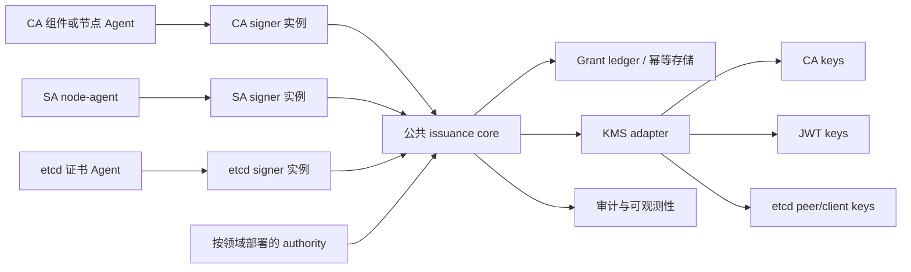

# Kubernetes Credential Issuance Platform：外部组件实现方案

**状态：** Phase 0-3 参考实现已落地；生产加固和 Phase 4 仍未完成
**日期：** 2026-10-28
**拟定仓库名：** `k8s-credential-issuance`

本文归档 Kubernetes CA Issuance V2、ServiceAccount JWT Issuance V2 和 etcd CA Issuance V2 共同依赖的外部组件实现方案。

目标架构是：一个仓库、一个公共 issuance core、三个领域插件，以及多个隔离的运行时实例。共享代码用于降低维护成本，但不共享安全信任边界。领域专用的密钥、身份、策略、ledger 和运行时凭据必须保持隔离。

## 1. 架构决策

平台分为四层：

1. **Issuance core：** Grant 校验、请求 canonical binding、replay/幂等、fail-closed 签发流水线、KMS 代理、审计、generation 状态和通用传输。
2. **领域插件：** CA/X.509、ServiceAccount/JWT、etcd peer/client 证书策略和结果处理。
3. **外部服务与 Agent：** Authority、signer、ledger、KMS adapter、审计、轮换控制器和节点/worker Agent。
4. **隔离运行实例：** 使用同一仓库构建，但分别部署 CA、ServiceAccount 和 etcd 实例。



请求中的 domain 字段本身不是可信授权依据。每个 signer 实例固定服务于一个领域，并拒绝其他领域的请求、Grant、key reference 和 ledger 记录。

## 2. 仓库结构

```text
k8s-credential-issuance/
  api/
    grant/v1/
    signrequest/v1/

  internal/issuance/
    core/
      pipeline/
      grant/
      ledger/
      kms/
      audit/
      generation/
      transport/
    domains/
      ca/
        csr/
        profiles/
        x509issuer/
        status/
      sa/
        claims/
        jwtissuer/
        jwks/
      etcd/
        membership/
        peer/
        client/
        quorum/

  internal/authority/
    core/
    domains/ca/
    domains/sa/
    domains/etcd/

  internal/agent/
    client/
    identity/
    transport/
    retry/

  cmd/
    ca-authority/
    ca-signer/
    ca-cert-agent/
    ca-rotation/
    sa-authority/
    sa-signer/
    sa-node-agent/
    etcd-authority/
    etcd-signer/
    etcd-cert-agent/
    etcd-rotation/
```

这些命令可以共用实现和构建系统，但生产进程必须拥有固定的 domain 配置和独立身份。

## 3. 公共 issuance core

### 3.1 Grant 外层结构

公共 core 负责带签名的 Grant 外层结构，至少包含：

```text
version
domain
grant_id
request_id
identity_ref
binding_digest
generation
key_id
policy_version
not_before / expires_at
nonce
带类型的领域 payload
signature
```

payload 必须有明确领域类型并使用 canonical 编码。CA Grant 绑定 CSR digest、公钥 digest、signer profile、SAN、用途和 TTL；SA Grant 绑定 claims、ServiceAccount UID、可选 Pod UID、audience、issuer、cluster ID 和 TTL；etcd Grant 绑定 cluster instance、member/client identity、endpoint SAN、peer/client profile、etcd role、公钥、generation 和 TTL。

公共 core 必须拒绝未知 domain、版本、算法、key ID 和 payload 类型，不能把调用方控制的通用 map 当作授权策略。

### 3.2 统一签发流水线

安全敏感操作顺序由 core 固定：

```text
认证请求
  -> 读取最新请求
  -> 领域 canonicalization 和 digest
  -> 校验 Grant 签名和时间范围
  -> 校验精确领域绑定和策略
  -> 原子预留 Grant
  -> 生成受限 SigningIntent
  -> 调用允许的 KMS key
  -> 持久化准确结果
  -> 通过领域 adapter 回传结果
  -> 写入审计事件
```

领域插件只提供解析、绑定、策略、签名模板和结果交付 hook，不能绕过 Grant 预留、KMS allowlist、幂等或审计处理。

### 3.3 公共接口

接口应当是强类型且最小化的。下面的设计形状冻结契约边界；只要不改变
文档定义的语义，实现可以选择等价的具体类型：

```go
type IssuancePlugin interface {
    Domain() Domain
    Canonicalize(ctx context.Context, request Request) (Binding, error)
    ValidateBinding(ctx context.Context, grant Grant, binding Binding) error
    Prepare(ctx context.Context, grant Grant, binding Binding) (SigningIntent, error)
    Finalize(ctx context.Context, result SignedResult) (Delivery, error)
}

type Ledger interface {
    Reserve(ctx context.Context, key ReservationKey) (Reservation, error)
    Complete(ctx context.Context, operationID string, result SignedResult) error
    Lookup(ctx context.Context, operationID string) (SignedResult, error)
}

type KeyProvider interface {
    Sign(ctx context.Context, intent SigningIntent) (Signature, error)
}

type Agent interface {
    Domain() Domain
    Request(ctx context.Context, request AgentRequest) (AgentResult, error)
    Verify(ctx context.Context, result AgentResult) error
    Deliver(ctx context.Context, result AgentResult) error
}
```

`KeyProvider` 只是内部 broker，不能成为公开的任意字节签名 API。它必须在调用 Infisical KMS 或其他 HSM/KMS 前校验 domain、purpose、algorithm、key reference 和 operation ID allowlist。

### 3.4 Ledger 与结果恢复

Ledger 位于控制面信任边界之外，必须支持多个 signer 实例之间的原子预留。预留记录至少包含 Grant ID、domain、请求 digest、目标身份、CSR/claims UID、operation ID 和 key generation。

KMS 成功后，必须在交付前持久化准确的证书或 token 结果。signer 崩溃后重试应返回已经记录的结果，不能签出第二个 artifact。Ledger 需要支持可重试、已完成、已撤销和永久失败状态，并为每次状态变化保留审计证据。

不同领域可以共用一个 backend，但必须使用独立 namespace、按服务授权和领域级唯一性约束。高安全部署可以使用独立的物理存储。

## 4. External authority 实现

Authority 使用公共服务框架和领域策略模块：

```text
authority core
  registration store
  identity verifier / attestation verifier
  policy engine
  Grant issuer
  revocation 和 generation blocking
  authority audit
```

推荐的运行实例为 `ca-authority`、`sa-authority` 和 `etcd-authority`。它们可以共享源代码，但必须使用不同的 Grant 签名 key、注册 namespace、策略 namespace、mTLS 身份和审计流。

Authority 不能只根据 Kubernetes Node、CSR approval、master 持有的 kubeconfig 或不可信控制面转发的 ServiceAccount token 推断授权。

## 5. Signer 实现

Signer 是围绕一个领域插件的公共服务外壳：

```text
协议 adapter
  -> issuance core
  -> 一个领域插件
  -> KMS broker
  -> 领域结果 writer
```

生产环境分别部署 signer：

| 实例 | 请求路径 | 结果 | 必须隔离的内容 |
|---|---|---|---|
| `ca-signer` | CSR watch/status 或受限 direct request | leaf 加 intermediate chain | 仅 CA profile 和 CA intermediate key |
| `sa-signer` | worker/provider direct request | 绑定后的 JWT | 仅 JWT key 和 JWKS |
| `etcd-signer` | direct request 或受限 CSR relay | peer 或 client 证书链 | 仅 peer/client profile 和 key |

每个 signer 都有固定的允许 domain、Grant issuer key、KMS key、ledger namespace 和出口策略。Signer 不能 approve CSR、读取 Secret、修改 RBAC 或使用 `admin.conf`。

## 6. 领域插件职责

### 6.1 Kubernetes CA 插件

CA 插件实现：

- PKCS#10 解析和准确 CSR digest；
- `signerName`、profile、公钥、Subject、SAN、EKU、key usage、TTL 和 generation 绑定；
- `kubelet-client`、`kubelet-serving`、`control-plane-client`、`api-server-serving` 和 administrator 等 allowlist profile；
- 受限 X.509 template 和 leaf-first 证书链输出；
- 使用兼容 CSR carrier 时的 status 回写；
- trust bundle 发布以及 profile/generation 轮换。

CA 插件不能接受调用方提供的任意证书模板，也不能让无关信任域共用一个在线 intermediate。

### 6.2 ServiceAccount JWT 插件

SA 插件实现：

- canonical claims 序列化和 claims digest；
- ServiceAccount、Pod、audience、issuer、cluster、过期时间和 generation 的精确绑定；
- 使用不可导出 signing key 创建受限 JWT；
- JWKS 和 key metadata 发布；
- active/previous generation 重叠和紧急 key 移除；
- node-agent/provider 交付和 projected-token 刷新语义。

JWT 插件不能暴露任意 claims 或通用字节签名。生产 worker identity 和 attestation 属于单独的部署工作。

### 6.3 etcd CA 插件

etcd 插件实现：

- 独立的 `etcd-peer` 和 client profile；
- cluster-instance、member/client identity、endpoint SAN、公钥、generation、TTL 和 role 绑定；
- peer/client CA key 分离；
- 证书安装及 reload/restart 结果处理；
- quorum-aware peer rotation 和 client rotation；
- membership、snapshot restore 和 member replacement 生命周期 hook；
- client identity 到 etcd user/role 的映射。

插件不能因为签发了证书就直接执行 membership mutation；成员变更必须由独立的授权 workflow 执行。

## 7. Agent 实现

公共 agent library 提供 mTLS、身份交换、请求关联、有界重试、本地状态和结果校验。领域 Agent 提供具体 artifact 行为：

- `ca-cert-agent`：本地 key/CSR、Grant 获取、证书安装、续期和组件 reload；
- `sa-node-agent`：worker attestation、direct Grant/token 请求、kubelet `TokenProvider`/`RemoteProvider` 和 Unix socket 交付；
- `etcd-cert-agent`：peer/client key 和 CSR、独立文件权限、reload/restart、续期和 quorum 调度。

Authority 或 signer 不可用时，Agent 不能回退到本地 CA 签名、auto-TLS、明文或控制面凭据。

## 8. KMS、信任和轮换

仓库中只保留一个 KMS provider interface 和各 provider adapter，但生产 key policy 必须按领域区分：

```text
CA:   按 profile/generation 区分的 X.509 intermediate key
SA:   active/standby JWT signing key
etcd: 独立的 peer/client intermediate key
```

每个 adapter 都必须验证不可导出、兼容算法、key version、disable/retirement、短期 machine identity 或 mTLS、审计证据以及 operation-ID 幂等或结果恢复。

公共 generation 状态机处理状态迁移和安全检查，领域控制器处理具体效果：

- CA：证书链 trust bundle 和叶子连接 drain；
- SA：JWKS、verifier cache 上限和 token drain；
- etcd：peer/client overlap bundle、成员 reload/restart、quorum 检查和旧连接 drain。

## 9. 运行时隔离契约

每个生产实例必须具备：

- 不能被请求修改的固定 domain 配置；
- 独立的服务身份和 mTLS 证书；
- 领域专用的 EAA signing-key trust set；
- KMS key reference 和 purpose allowlist；
- 隔离的 ledger namespace 和审计流；
- 只允许访问 authority、ledger、audit sink 和指定 KMS key 的网络策略；
- 独立的 readiness、指标、告警、备份和恢复流程。

共享数据库集群、KMS endpoint 或 binary 只有在这些控制仍可强制执行时才可接受。不能共享私钥、signer credential 或不受限的策略管理权限。

### 9.1 当前仓库状态

当前仓库已经包含冻结 CA、SA 和 etcd 契约的可运行参考路径：

- `api/grant/v1` 和 `api/signrequest/v1` 定义公共 Grant 及 SA direct request/response 类型；
- `internal/issuance/core` 实现 canonical JSON、Compact JWS Grant、replay state、ledger reservation/结果恢复、受限 KMS intent、audit、generation、transport helper 和有序签发流水线；
- `internal/issuance/domains/sa` 实现 SA plugin、signer 和 node-agent/provider 路径；
- `internal/issuance/domains/sa/attestation.go` 实现带签名的远程 attestation resolver、request digest binding、replay protection 和 fail-closed endpoint 处理；
- `internal/authority/domains/sa` 实现 registration、worker proof 校验、Grant 签发、撤销和 authority endpoint；
- `internal/issuance/domains/ca` 实现有界 CSR 解析、profile policy、CA plugin/signer、证书 Agent、CSR status controller 和证书轮换路径；
- `internal/authority/domains/ca` 实现 registration、worker proof 校验、Grant 签发、撤销和 CA policy endpoint；
- `internal/issuance/domains/etcd` 实现 peer/client profile、etcd plugin/signer、direct 证书 Agent、文件安装和 quorum-aware rotation；
- `internal/authority/domains/etcd` 实现 member/client registry、member replacement、snapshot restore、role-bound Grant 签发和撤销；
- `internal/issuance/core/kms/x509.go` 实现受限的开发用 X.509 backend 和 leaf-first chain 校验；生产环境仍需外部不可导出的 KMS/HSM adapter；
- `cmd/sa-authority`、`cmd/sa-signer` 和 `cmd/sa-node-agent` 提供可独立部署的进程入口。

SA plugin 还会 allowlist 支持的 JWT claims 结构，并将其中的安全相关字段逐项与已验证 binding 比较。仅有合法的 claims digest 不能授权不同的 audience、issuer、subject、有效期或 Kubernetes workload UID。

这仍是参考实现，不是生产退出。仓库内 file store 是单进程存储，不是 HA 事务 backend；node-agent 配置使用静态 binding resolver；命令只对非 loopback listener 强制 server-side TLS，还没有完整的双向 TLS identity provisioning。Signer 默认接受冻结的 `issuance/v1` Compact JWS；SA 领域另外提供显式 opt-in 的旧 Kubernetes staging `TokenGrant` JSON envelope 兼容 adapter。该 adapter 会先把旧 envelope 转成公共 core 消费的类型化 Grant，并由 wire shape 和端到端测试覆盖。配置方式和剩余生产边界见 [SA 部署说明](../deployment/sa-issuance.zh-CN.md)。

## 10. 实施 TODO

### Phase 0：冻结契约

- [x] **DONE——定义公共 Grant envelope 和领域类型 payload。**
- [x] **DONE——定义 ledger reservation、结果恢复、撤销和审计契约。**
- [x] **DONE——定义 KMS `SigningIntent` 和按领域的 key allowlist。**
- [x] **DONE——定义领域插件和 Agent 接口。**

### Phase 0 退出记录

**状态：** 已完成——文档与契约冻结，2026-10-28。

| 清单项 | 证据 | 结果 |
|---|---|---|
| Grant envelope 和类型化 payload | [Grant 契约](../contracts/issuance-v1.zh-CN.md#3-grant-契约)、[领域 binding](../contracts/issuance-v1.zh-CN.md#4-领域-binding) 及上文 §3.1 | PASS |
| Ledger reservation、结果恢复、撤销和审计 | [Authority 契约](../contracts/issuance-v1.zh-CN.md#6-authority-契约)、[Ledger 契约](../contracts/issuance-v1.zh-CN.md#8-ledger-与幂等契约) 及[失败语义](../contracts/issuance-v1.zh-CN.md#10-错误重试与-fail-closed) | PASS |
| 受限 KMS `SigningIntent` 和 key allowlist | [KMS 契约](../contracts/issuance-v1.zh-CN.md#9-kms-契约) 及上文 §3.3/§8 | PASS |
| 领域插件和 Agent 接口 | 上文 §3.3、§7 及[请求/Signer 契约](../contracts/issuance-v1.zh-CN.md#5-请求与响应-carrier) | PASS |

Phase 0 已在契约/文档层面闭环。Phase 1 参考实现和可执行测试记录如下；部署和生产验收仍是独立 gate。

### Phase 1：抽取公共平台

- [x] **DONE——在 `internal/issuance/core` 中实现 Grant、replay、ledger、KMS、audit、generation 和 transport。** 证据：`internal/issuance/core` 包树、各 package test 以及 `internal/issuance/core/pipeline` 的有序流水线。
- [x] **DONE——将 SA 领域行为放到 SA plugin，并保留 direct endpoint 的 JSON 字段形状。** `issuance/v1` Compact JWS 是默认 wire format。SA 领域另外提供显式的 `grant_format=legacy-token-grant` authority 模式和 `allow_legacy_token_grant=true` signer 模式，用于旧 Kubernetes staging `TokenGrant` envelope；adapter 会在进入公共 core pipeline 前完成转换。证据：`internal/issuance/domains/sa`、`internal/authority/domains/sa`、兼容测试和 [SA 部署说明](../deployment/sa-issuance.zh-CN.md)。
- [x] **DONE——增加跨领域 contract test 和 fail-closed 测试。** 证据：pipeline 跨领域、audit 不可用、KMS 失败、精确重试、ledger 并发/重启、generation、Grant、canonicalization、KMS operation-ID、SA claims binding、transport 以及 SA E2E 测试。

### Phase 1 退出记录

**状态：** 参考实现完成——2026-10-28。本记录不批准生产 rollout。

| 清单项 | 证据 | 结果 |
|---|---|---|
| 公共 core 模块和有序流水线 | `internal/issuance/core/**` 及 `go test ./...` | PASS |
| SA authority、signer、node-agent、claims binding 和 direct flow | `internal/authority/domains/sa/**`、`internal/issuance/domains/sa/**`、`TestSignerRejectsClaimsThatDoNotMatchTheBinding` 及 `internal/issuance/domains/sa/e2e_test.go` | PASS |
| 跨领域、fail-closed、并发、重启和精确重试 | `internal/issuance/core/*/*_test.go` 及 SA E2E test | PASS |
| HA store、生产 attestor 部署、完整 mTLS identity provisioning 和生产 KMS/audit 部署 | Phase 4 部署控制 | OPEN |
| 旧 staging `TokenGrant` wire compatibility | `internal/issuance/domains/sa/legacy.go`、legacy authority/signer/node-agent E2E 及协议测试 | PASS |

### Phase 2：接入 CA

- [x] **DONE——实现 CA plugin、CA authority policy、CA signer、证书 Agent 和 CA rotation/status controller。** 证据：`internal/issuance/domains/ca/**`、`internal/authority/domains/ca/**`、通用 binding proof 及 CA E2E test。
- [x] **DONE——验证 CSR status、profile 隔离、证书链输出和 CA key 约束。** 证据：有界 PKCS#10 解析、精确 Grant/profile binding、`TestCertificateAgentIssuesLeafAndIntermediateWithoutRoot`、`kms.ValidateCertificateChain` 以及按 purpose/profile 的 KMS policy。

### Phase 2 退出记录

**状态：** 参考实现完成——2026-10-28。本记录不批准生产 rollout。

| 清单项 | 证据 | 结果 |
|---|---|---|
| CSR、公钥、signer、profile、SAN、usage、TTL binding | `internal/issuance/domains/ca/csr`、`internal/issuance/domains/ca/plugin.go`、`internal/authority/domains/ca/authority.go` | PASS |
| Authority policy、worker proof、Grant 签发和撤销 | `internal/authority/domains/ca/**` | PASS |
| Signer、受限 X.509 KMS、精确结果恢复和证书链输出 | `internal/issuance/domains/ca/signer.go`、`internal/issuance/core/kms/x509.go` 及 CA E2E test | PASS |
| CSR status 交付和轮换 controller | `internal/issuance/domains/ca/agent.go`（`StatusController`、`RotationController`） | PASS |
| HA ledger、生产 KMS/HSM 和完整 mTLS provisioning | Phase 4 部署控制 | OPEN |

### Phase 3：接入 etcd

- [x] **DONE——实现 member/client registry、etcd plugin、证书 Agent、role mapping 和 quorum-aware rotation。** 证据：`internal/authority/domains/etcd/**`、`internal/issuance/domains/etcd/**`、peer/client purpose 分离和 quorum tests。
- [x] **DONE——验证 member replacement、snapshot restore、peer rotation 和 client rotation。** 证据：`TestMemberReplacementAndSnapshotRestore`、`ValidateQuorum`/`CanRotatePeer`、`RotationController.RotatePeers` 和 `RotationController.RotateClient`。

### Phase 3 退出记录

**状态：** 参考实现完成——2026-10-28。本记录不批准生产 rollout。

| 清单项 | 证据 | 结果 |
|---|---|---|
| Member/client registration 和 snapshot recovery | `internal/authority/domains/etcd/authority.go` 及 `TestMemberReplacementAndSnapshotRestore` | PASS |
| Cluster/member/client/profile/role/public-key binding | `internal/issuance/domains/etcd/plugin.go`、`internal/authority/domains/etcd/authority.go` | PASS |
| Peer/client CA purpose 和 key 分离 | `internal/issuance/domains/etcd/profile.go` 及受限 KMS policy | PASS |
| Quorum-aware peer rotation 和独立 client rotation | `internal/issuance/domains/etcd/agent.go` 及 `TestQuorumRotationRequiresOverlapAndPreservesMajority` | PASS |
| HA registry/ledger、etcd 集成故障注入和生产 mTLS | Phase 4 部署控制 | OPEN |

### Phase 4：生产部署加固

- [ ] **TODO——使用独立凭据和 key 部署各领域实例。**
- [ ] **TODO——配置 HA ledger、审计留存、KMS 恢复、告警和故障注入测试。**
- [ ] **TODO——从控制面移除本地 CA/JWT key material 以及所有签名 fallback。**

## 11. 验收标准

只有满足以下条件，平台才可称为生产就绪：

1. 一个领域的 Grant 会被其他所有领域 signer 拒绝；
2. 修改身份、公钥、profile、endpoint、role、generation 或 TTL 都会被拒绝；
3. 并发 signer 只能消费一次 Grant，重试返回完全相同的已记录结果；
4. 没有公开 endpoint 可以请求任意字节、任意 JWT claims 或任意 X.509 template；
5. KMS、authority、ledger、audit 或控制面故障时，新签发 fail-closed；
6. CA、SA 和 etcd 的 key、凭据、trust bundle 及轮换流程可以分别审计；
7. 领域轮换和灾备测试不依赖控制面私钥。

## 12. 相关文档

- [Credential Issuance Contract v1](../contracts/issuance-v1.zh-CN.md)
- CA、ServiceAccount 和 etcd 的实现清单继续维护在安全设计工作区。
